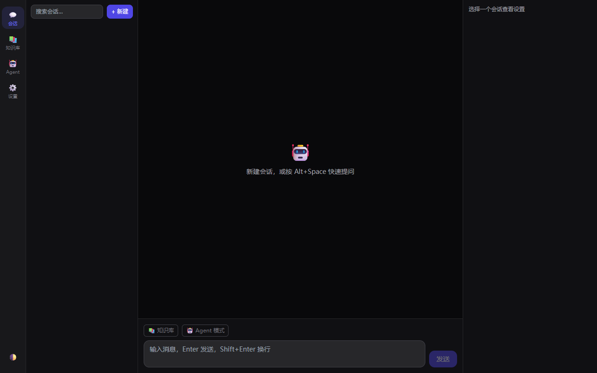
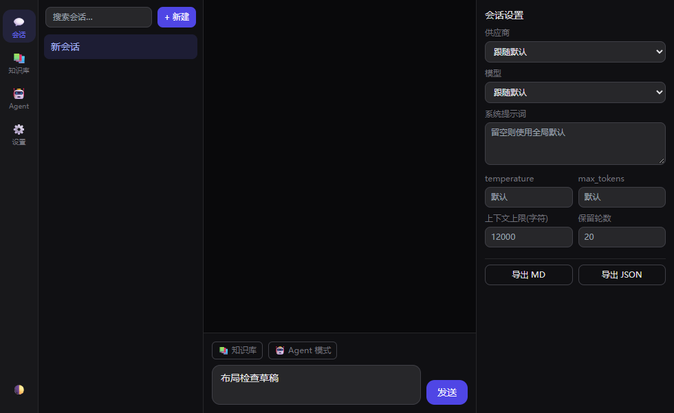
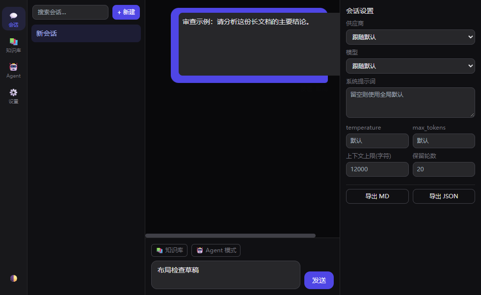
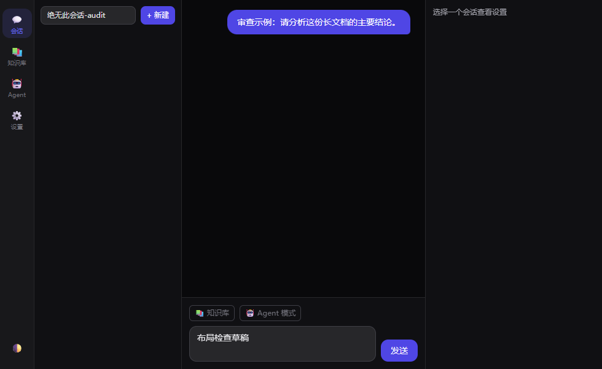
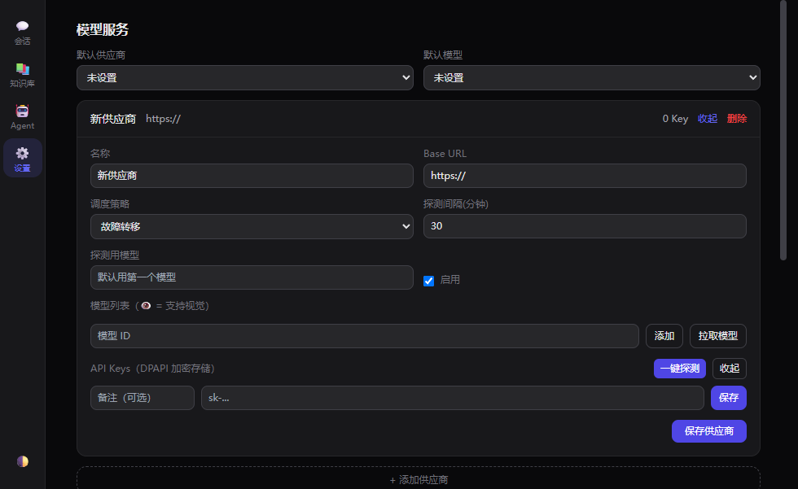
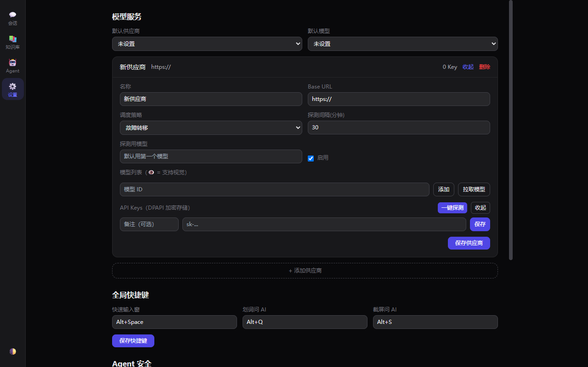
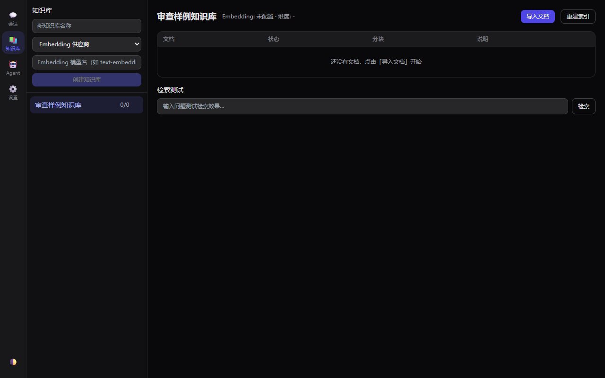
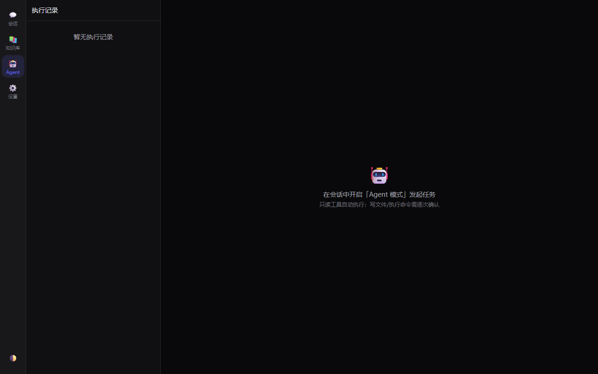
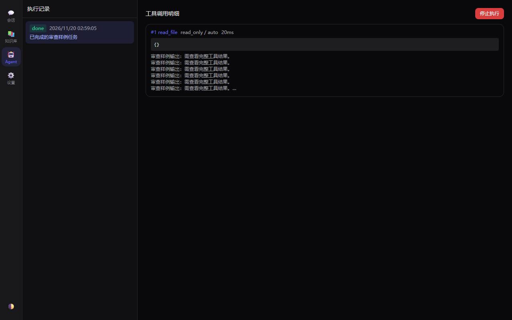

# miniagent 前端布局与易用性整改报告

日期：2026-11-20  
对象：miniagent 1.0.0 Windows 桌面端，当前工作区源码及本次构建产物  
交付范围：现状审查、问题清单、整改方案、排期建议与验收标准。本次未修改前端业务源码。

## 1. 结论与整改顺序

当前使用不便的主要原因是：固定侧栏挤占任务区、高频操作入口隐蔽、配置流程缺少引导，以及部分界面状态与实际数据不一致。应优先保证“配置可用服务 → 开始提问 → 阅读和处理回复”的主流程，再调整视觉风格。

本报告共列出 **22 项问题：P1 9 项、P2 11 项、P3 2 项**。P1 表示影响核心操作或可能导致用户输入、配置误操作，应在下一次对外使用前修复；P2 表示明显增加操作成本，应随布局整改完成；P3 表示一致性和体验优化。未发现足以判定为 P0 的证据。

最先处理以下问题：

1. 收起常驻会话设置，恢复聊天区宽度；消除消息编辑溢出。
2. 修复会话搜索的返回值契约错误及搜索引起的会话设置消失。
3. 补齐删除保护、输入法组合输入判断、发送失败草稿恢复。
4. 修复历史消息重新生成目标、文档删除后刷新、设置初始值同步。
5. 将设置拆成有导航的分组，并为首次配置提供明确路径。

## 2. 审查方法和证据边界

检查了主窗口、会话、知识库、Agent、设置，以及消息、确认卡片、全局样式、相关 Pinia store 和 IPC。快速问答、悬浮球、截图入口进行了源码检查。

Browser 插件未提供（Browser plugin not available），因此使用项目现有 `playwright-core` 直接驱动 Electron。执行 `npm run build` 成功后，以 `MINIAGENT_USER_DATA` 指向临时目录启动独立实例，没有读取或改写日常使用的用户数据。没有配置真实 Key，也没有调用外部模型服务。

实测流程：加载应用 → 新建会话 → 输入草稿 → 切换页面 → 编辑示例消息 → 搜索会话 → 展开供应商和 Key 配置 → 创建示例知识库 → 查看 Agent 空态及已完成任务示例。

消息编辑和 Agent 长结果使用内存中的审查样例数据，分别用于复现组件布局和状态显示，不能据此认定真实模型调用或 Agent 执行成功。供应商、会话、知识库通过真实界面写入临时数据目录。

证据等级：**实测**为本次真实渲染或交互确认；**源码确认**为直接可见的实现缺陷；**待专项验证**为需输入法、后端失败、重启数据等条件进一步验证的风险。建议尺寸和排期属于设计目标，不是当前已实现能力。

### 2.1 本次检查结果

| 检查 | 结果与范围 |
|---|---|
| 当前源码构建 | 通过，主进程、preload、四个渲染入口均产出 |
| 页面身份 | `out/renderer/entries/main-window/index.html`，标题 `miniagent` |
| 非空页面 | 会话、设置、知识库、Agent 均有实际内容及截图 |
| 框架错误遮罩 | 未检测到 `vite-error-overlay`，已查看截图无构建错误遮罩 |
| 控制台 | 本次监听期间无 console error / pageerror；不覆盖监听注册前的启动日志 |
| 桌面渲染 | 1280 × 800 内容视口 |
| 最小窗口附近 | 980 × 601 内容视口；Windows 原生边框导致与请求的 980 × 600 有 1px 高度差 |
| 草稿切页 | 输入后切换设置再返回，文本仍保留；跨会话草稿隔离未通过此项验证 |
| 核心交互 | 新建、配置展开、建库可操作；搜索、消息编辑发现缺陷 |
| 未覆盖 | 手机端、真实模型请求、真实输入法、读屏、系统缩放、多显示器、真实文档导入和权限确认链路 |

应用声明主窗口最小尺寸为 980 × 640（外窗），目标是 Windows 桌面端，因此本次以桌面及最小窗口为主要布局基线，没有把手机适配当作当前必备能力。

### 2.2 实测空间分配

| 内容视口宽度 | 全局导航 | 会话列表 | 会话设置 | 聊天区域 | 聊天区域占比 |
|---|---:|---:|---:|---:|---:|
| 1280px | 56px | 240px | 288px | 696px | 54.4% |
| 980px | 56px | 240px | 288px | 396px | 40.4% |

聊天区内部还有左右各 24px 留白，980px 视口下消息可用宽度约 348px。编辑输入框固定 384px，尚未计入气泡内边距就超过可用区域。整页 `body` 无横向溢出并不代表消息区域没有横向滚动。

原始记录：[observations.json](frontend-audit-2026-11-20/observations.json)。

## 3. P1 问题与整改要求

### F01 固定三栏挤压核心聊天区域

- **证据：实测。** `src/views/ChatView.vue:124` 会话列表固定 240px，`:294` 详情固定 288px；`src/stores/ui.js:19` 默认显示详情。全项目未找到改变 `showDetails` 的界面入口。无会话时右侧仍占整栏，只显示提示。见截图 01、02。
- **影响：** 最小窗口近六成宽度用于导航和设置，聊天文本频繁换行；低频高级参数长期占据主工作区。
- **整改：** 增加会话标题栏和“会话设置”按钮，详情默认收起；窄窗口以覆盖式抽屉展示，宽窗口允许用户主动停靠。会话列表支持收起、拖动宽度和记忆状态。
- **验收：** 980px 内容宽度下，详情收起时聊天区至少 640px；展开设置不把聊天区挤到 396px。无会话时不显示空详情栏；展开、关闭均有按钮及键盘路径。

### F02 消息编辑框固定宽度导致遮挡和横向滚动

- **证据：实测。** `src/components/MessageItem.vue:64` 使用 `w-96`。980px 视口编辑样例消息时，输入框宽 384px，右边界约 747.84px；聊天区右边界为 692px。截图 03 可见输入框被详情区域遮住，消息区出现横向滚动条。
- **整改：** 编辑容器 `min-width:0; max-width:100%`，输入框随可用空间伸缩；消息气泡、附件、长链接和表格同时检查约束。代码块保留自身横向滚动。
- **验收：** 在最小窗口编辑中英文长文本，完整看到输入框、提交和取消；聊天区不因编辑器产生横向滚动。

### F03 会话搜索契约错误，并破坏当前会话状态

- **证据：实测及源码确认。** `src/views/ChatView.vue:70` 把搜索结果当 ID 数组，执行 `ids.includes(c.id)`；`electron/store/repos.js:251–268` 实际返回会话对象数组。搜索“新会话”时 API 返回 1 条，UI 为 0 条。搜索直接覆盖 `chat.conversations` 后，`activeId` 和消息仍存在，但由列表派生的 `activeConv` 变为 null，右侧设置消失。清空搜索文本不按 Enter，列表仍为 0。见截图 04。
- **整改：** 统一搜索返回结构；完整会话数据与筛选结果分开存放，活动会话独立取值。搜索框提供清空按钮、匹配数和无结果提示；清空即恢复，内容变更采用防抖或明确搜索按钮。
- **验收：** 标题和正文关键词均能返回真实匹配项；无匹配不影响当前会话设置；清空立即恢复列表；聊天事件刷新不重置现有筛选条件。

### F04 删除入口缺少防误触和界面恢复路径

- **证据：源码确认。** 会话行直接 `chat.removeConv`；知识库直接 `kb.remove`；设置中的供应商和 Key 直接调用删除。对应仓储使用软删除，但前端没有回收站、撤销或删除确认。相关位置：`ChatView.vue:174`、`KbView.vue:99`、`SettingsView.vue` 的删除按钮及各 store。
- **影响：** 悬停出现的删除按钮邻近其他操作，误点击后内容从界面消失；底层软删除不等于用户可恢复。
- **整改：** 会话等可恢复对象增加撤销及恢复能力；知识库、供应商、Key 显示具体对象和影响范围后确认，默认焦点放在取消。
- **验收：** 取消不写库；确认仅处理目标对象；可撤销操作能在 UI 恢复；不能恢复的操作明确说明。列表项点击与删除不相互误触发。

### F05 Enter 发送未排除中文输入法组合输入

- **证据：源码确认，真实输入法待专项验证。** `ChatView.vue:59` 和 `src/entries/quick-panel/App.vue:95` 只检查 Enter 与 Shift，没有 `isComposing` 或组合输入状态判断。
- **整改：** 组合输入期间不发送；统一主窗口与快捷窗口的发送按键逻辑，保留 Shift+Enter 换行。
- **验收：** 微软拼音输入候选词时 Enter 只确认候选；组合结束后 Enter 才发送；Shift+Enter 始终换行。

### F06 发送前清空草稿和附件，失败时缺少恢复

- **证据：源码确认，异常请求待专项验证。** `ChatView.vue:50` 在 await 请求前清空文本和截图附件，没有失败恢复与发送中锁。键盘路径也未用 `chat.hasStreaming` 限制再次发送。快速问答的 `sendText` 同样先清空输入与选中文本，等待响应后才设置 `streamingId`。
- **整改：** 保存本次发送快照，加入 submitting 状态；明确流式期间的并发策略；失败保留或恢复原输入和附件，并提供重试。区分普通对话和 Agent 运行状态。
- **验收：** 无服务配置、请求拒绝、IPC 失败时草稿可找回；连续 Enter 不产生意外重复请求；发送中、生成中、失败、重试有明确反馈。

### F07 历史回答的重新生成按钮实际处理最后一条回答

- **证据：源码确认。** `MessageItem.vue:23` 不传消息 ID，所有回答按钮均调用 `chat.regenerate()`；`src/stores/chat.js` 从后往前移除最后一条 assistant，再调用当前会话重新生成。
- **影响：** 用户点击较早回答下的按钮，却修改会话末尾，操作目标与位置不一致。
- **整改：** 若只支持末条重生成，仅在末条可操作回答展示按钮；若支持历史分支，传目标消息 ID 并明确后续消息处理方式。
- **验收：** 三轮以上对话逐条检查，按钮展示与实际目标一致；不会因点击历史回答修改无关末条消息。

### F08 删除知识库文档后列表未同步

- **证据：源码确认。** `src/stores/kb.js` 的 `removeDoc` 只返回 IPC 请求；未删除本地 `docs` 项，也不重新加载。`electron/main/ipc.js` 的 `kb:removeDoc` 仅软删除并返回 true，没有在该处理器发刷新事件。
- **整改：** await 删除成功后更新文档列表和统计；失败保留原行并提示。删除与导入、重建并发时统一刷新策略。
- **验收：** 删除成功后该行立即消失，数量同步；切库再返回不回弹；失败显示错误且不误删本地行。

### F09 设置表单可能使用初始化前的默认值

- **证据：源码确认，带持久化数据重启待专项验证。** `SettingsView.vue:22` 挂载时将 store 的快捷键、授权目录、工作目录和步骤上限复制到本地 ref。`App.vue` 用 `v-show` 同时挂载各视图，父组件 mounted 中才 await `settings.init()`，初始化后没有对应 watch 同步表单。
- **影响：** 存储值和表单值可能不同，用户点击保存可能用默认值覆盖原配置。
- **整改：** 增加初始化完成状态后再挂载编辑表单；或在初始化完成时同步草稿，避免后续刷新覆盖用户正在编辑的内容。保存失败不能提示成功。
- **验收：** 预存非默认快捷键、授权目录、工作目录和步骤上限，重启后逐项显示一致；加载中不能提交默认值；初始化后编辑不会被异步刷新冲掉。

## 4. P2 问题与整改要求

### F10 设置是连续长表单，缺少定位和固定操作区

**证据：实测。** `SettingsView.vue:146` 起为单个滚动容器，供应商展开后占据大部分首屏；快捷键、Agent、数据与外观向下排列。最小窗口下一个供应商配置已占近整个可视高度，见截图 05、06。

**整改：** 分为“模型服务、快捷键、Agent、外观、数据”五组，通过页内导航或标签切换；供应商使用独立编辑面板，高级参数折叠，保存区保持可见。**验收：** 任一设置分组一次点击可达，保存无需滚到底，切组时能识别未保存更改。

### F11 供应商草稿和保存边界不清晰

**证据：源码确认及界面实测。** “添加供应商”直接持久化 `https://` 占位记录，没有自动进入编辑；供应商保存与 Key 保存分为两个按钮，收起和切换供应商没有脏数据提醒。截图 05 中两个保存入口并存。

**整改：** 添加先进入未保存编辑态，基础信息、Key、模型按步骤组织；说明哪些操作立即生效、哪些需要保存。增加取消、校验和未保存离开提示。**验收：** 取消新增不留空记录；无效 URL 不可保存；收起/切换不会静默丢草稿；Key 保存成功后其状态清楚可见。

### F12 首次使用缺少“配置到可提问”的引导

**证据：实测。** 空态仅提示新建会话或 Alt+Space；未配置供应商时仍有发送入口。模型服务页顶部要求选择默认供应商和模型，但未给出完整准备顺序。截图 01、06。

**整改：** 在聊天空态显示“配置服务 → 添加 Key → 选择模型 → 验证连接”的可点击清单，显示当前准备状态和有效模型；高级调度、探测参数后置。**验收：** 首次打开可直接进入缺失步骤；配置完成可返回并开始首轮对话；缺失项有明确解释。

### F13 常用操作隐藏，重命名依赖双击

**证据：源码确认及截图。** 会话置顶、删除和消息复制、编辑、重新生成均依赖 `opacity-0 group-hover:opacity-100`；重命名仅 `@dblclick`。消息生成/停止/错误状态文字也在同一个隐藏操作区内。见 `ChatView.vue:153`、`MessageItem.vue:87`。

**整改：** 用常驻“更多”入口承载次要操作，悬停和键盘聚焦均展示操作；运行、错误状态常驻；重命名提供菜单项。**验收：** 不猜测双击也能找到重命名；Tab 聚焦时能看清当前操作；错误状态无需鼠标悬停。

### F14 会话切换和生成过程缺少滚动位置策略

**证据：源码风险。** `ChatView.vue:41` 仅监听消息内容长度，渲染后计算距底部是否小于 200px；未按活动会话保存滚动位置，也没有“回到底部”入口。长消息更新后的高度可能使原本位于底部的视口脱离阈值。

**整改：** 用更新前的“是否贴底”判断自动跟随；阅读历史时保留位置并提示新内容；会话切换时恢复各自位置或明确滚到最新。**验收：** 持续生成时可跟随，主动上滚后不抢滚动；切换长会话不会出现旧滚动位置误用。

### F15 知识库创建表单挤占列表且缺少字段解释

**证据：实测。** 固定 256px 侧栏长期展示创建表单；Embedding 模型示例在输入框中截断，供应商、模型依赖 placeholder 解释；“0/0”没有单位。截图 07。

**整改：** 侧栏保留标题、搜索和新建按钮；创建放到对话框或抽屉，持久显示名称、供应商、模型标签和必填说明；可用模型优先选择，允许高级手填。统计改为“0 文档 · 0 分块”。**验收：** 字段含义不随输入消失；示例可完整阅读；列表空间不被长期创建表单占用。

### F16 知识库检索结果缺少空态、全文和切库隔离

**证据：源码确认。** `KbView.vue:221` 检索片段 `line-clamp-4` 无展开；没有区分未检索、检索中、无结果的完整状态。`src/stores/kb.js` 的 `select` 只切换文档，不清理 `searchResults`。

**整改：** 结果标记知识库和查询词；切库清空或按库保存结果；增加无结果解释、重试、展开全文和来源定位。**验收：** A 库结果不展示成 B 库结果；长片段可查看全文；未检索和零命中显示不同状态。

### F17 Agent 记录页不能完整阅读结果，完成态仍可停止

**证据：实测样例及源码确认。** `AgentView.vue:88` 用 `line-clamp-6` 截断结果且无展开；`:67` 只要选中 run 就展示“停止执行”，未判断运行状态。已完成样例中仍出现红色停止按钮，见截图 09。

**整改：** 顶部展示目标、状态、耗时和完成摘要；工具步骤可折叠，结果支持展开、复制和错误详情；仅运行中展示停止；为状态值提供中文标签。

**验收：** done/error/stopped 记录不显示可用停止按钮；超六行结果可读完；用户能从记录定位失败步骤和相关会话。

### F18 执行确认卡可能遮挡输入，队列与焦点管理不足

**证据：源码确认，真实确认链路待专项验证。** `ConfirmCard.vue:26` 固定右下角、宽 384px；没有最大高度、对话框语义或焦点管理；只显示 `confirms[0]`，不显示待处理数量。

**整改：** 采用可管理焦点的确认对话框或独立待确认面板，长内容内部滚动，展示待处理数量、目标路径及影响；确认后恢复焦点。**验收：** 980px 窗口下完整看到风险说明和两个决策按钮；键盘可完成允许/拒绝；多请求不会无提示积压。

### F19 快速问答缺少可点击发送和历史范围说明

**证据：源码确认。** 快速窗底部空闲态只有复制、主窗口按钮，发送完全依赖 Enter；`visibleMsgs` 只取最后 12 条但未提示；Escape 处理仅绑定输入框 keydown，自定义指令输入框等处没有统一处理。

**整改：** 增加发送按钮并保留快捷键；提示近期消息范围并提供主窗口查看完整历史；把关闭按键提升到窗口级，处理与输入法或弹层的优先级。**验收：** 鼠标完成输入与发送；有选择文本时自定义操作路径明确；焦点在各控件时 Esc 行为一致。

### F20 列表和反馈缺少键盘与辅助技术语义

**证据：源码确认。** 会话、知识库、Agent 记录为可点击 div，没有对应键盘选择处理；多处输入仅 placeholder，没有持久标签；全局 toast 没有 live-region，导航没有当前项语义。全局检索未发现这些视图中的 `aria-*`、`role`、`tabindex` 支持。

**整改：** 使用合适的按钮/列表语义，避免交互元素嵌套；补 accessible name、当前项、展开状态、错误关联、焦点可见样式和通知播报。**验收：** 仅用键盘可完成选会话、切库、查看记录；输入框可识别用途；读屏能识别当前页、按钮和请求状态。

## 5. P3 问题与整改要求

### F21 字号、术语和图标体系不一致

**证据：实测及源码确认。** 导航使用 10px 字号，表单大面积 12px；emoji 用作核心导航图标；`Agent`、`done`、`score`、`temperature`、`max_tokens` 等直接混入中文界面。截图 05、07、09。

**整改：** 导航和表单正文优先 14px，辅助说明至少 12px；统一图标与间距；用户可见文案使用“智能任务、已完成、相关度、随机性、最大输出长度”，技术名放帮助说明。建议普通控件高度至少 36px、主要操作 40px。

**验收：** 100%/125%/150% Windows 缩放下文字可读、按钮不截断；状态不只靠颜色区分。本文没有做对比度数值测量，不能据此宣称对比度不达标。

### F22 主题行为和操作反馈缺少统一规则

**证据：源码确认。** `src/stores/ui.js` 仅应用主题时读取系统色彩偏好，未监听系统变化；快速问答固定深色；toast 固定 4 秒消失；消息复制没有成功/失败反馈（代码块复制另有反馈）。

**整改：** 明确全窗口主题策略；系统模式监听变化；短成功提示自动消失，重要失败保留到用户关闭或处理；消息与代码复制反馈一致。**验收：** 系统主题变化时跟随生效；各窗口按约定一致；复制失败可识别，重要错误有再次查看入口。

## 6. 建议的信息架构与布局

### 6.1 会话页

```text
全局导航 | 可收起的会话列表 | 会话标题 · 当前模型 · 会话设置入口
         | 搜索 / 新建     | 对话阅读区
         | 会话列表        | 新内容提示 / 回到底部
         |                 | 附件、知识库、任务模式
         |                 | 输入框 / 发送或停止
```

设置从常驻栏改为按需打开；当前会话标题和实际使用模型在主区可见。高级采样、上下文和系统提示词放在设置面板内分组。导出进入会话菜单。

| 项目 | 建议约束 |
|---|---|
| 全局导航 | 保留约 56–64px；标签能清楚阅读，当前项有语义及视觉标记 |
| 会话列表 | 默认约 240px，可收起、调宽；长标题提供完整查看方式 |
| 详情面板 | 默认关闭；窄窗覆盖显示，宽窗允许主动停靠 |
| 聊天内容 | 居中阅读，建议最大宽度 840–960px；最小窗口主区至少 640px |
| 输入框 | 随内容增高，建议 2–8 行后内部滚动；不挤掉主要阅读区 |
| 断点 | 可先采用 1180px 作为详情覆盖显示的候选阈值，再按可用主区宽度验证 |

### 6.2 其他页面

- **设置：** 分组导航 + 当前组内容；供应商基础信息优先，Key 和模型各有清晰状态，高级配置按需展开。
- **知识库：** 资源列表 + 当前库内容；创建通过弹层完成，文档区与检索区可切换；导入、重建展示各自状态。
- **Agent：** 执行记录 + 目标及步骤详情；任务入口和运行状态保持可发现；确认请求有独立队列提示。

## 7. 实施计划与依赖

以下为单名前端工程师、已有后端接口可复用条件下的粗略工作日估算；涉及恢复接口、历史分支或授权协议变化时需后端共同评估。

| 阶段 | 范围 | 依赖与交付 | 估算 |
|---|---|---|---:|
| 第一批 主流程与数据一致性 | F01–F09 | 会话布局、输入可靠性、搜索契约、目标一致性；恢复能力需补接口 | 3–5 天 |
| 第二批 信息架构与操作入口 | F10–F19 | 设置分组、首次配置、资源创建、完整结果、快捷问答；接第一批状态模型 | 4–6 天 |
| 第三批 通用质量 | F20–F22 及整体回归 | 键盘语义、主题、字号、文案；关键语义可随前两批同步交付 | 2–3 天 |

不建议仅批量调颜色、圆角和间距作为验收交付。每批需让对应用户流程能够实际完成，并以行为回归和截图证明。

## 8. 整改后的验收清单

| 流程 | 必须达到的结果 |
|---|---|
| 首次启动 | 空配置能进入服务配置，添加 Key 和模型后可返回会话 |
| 最小窗口 | 980px 宽下无编辑遮挡；输入、发送、停止、设置关闭入口均可见 |
| 新建与切换 | 当前会话始终明确；草稿按约定保留，不串到无关会话 |
| 搜索 | 有匹配、无匹配、清空、生成中刷新均保持列表及活动会话正确 |
| 输入 | 微软拼音 Enter 不误发，Shift+Enter 换行；连续发送不重复提交 |
| 失败 | 模型错误或 IPC 失败可识别原因并找回输入；不显示虚假的保存成功 |
| 长内容 | 5 万字对话、长 URL、宽表格、代码、截图附件不撑坏页面 |
| 消息操作 | 编辑和重生成目标一致；复制结果有反馈；历史操作有明确规则 |
| 删除 | 能取消；成功同步界面；声明可撤销的对象能恢复 |
| 设置 | 非默认配置重启后显示一致；未保存离开有提示；错误字段可定位 |
| 知识库 | 删除文档立即更新；切库不串检索结果；可展开全文并定位来源 |
| Agent | 结果可读完，完成态不提供无效停止；待确认操作键盘可达 |
| 快捷问答 | 鼠标可发送，键盘可关闭，有完整历史入口 |
| 可访问性 | Tab 路径合理、焦点可见、图标有名称、状态可播报 |
| 显示环境 | 980px、1280px、1920px 宽及 100%/125%/150% 缩放回归，深浅主题核对 |

功能契约、输入法保护、失败恢复、设置初始化、删除刷新适合增加有行为意义的自动化回归；尺寸与排版使用渲染检查。构建成功不能代替用户流程验收。本次交付不代表上述整改项已经通过验收。

## 9. 截图证据

以下均为整改前现状，示例数据不含真实凭据。

### 01 桌面空态与常驻空详情栏



### 02 最小窗口附近的聊天区



### 03 消息编辑遮挡与内部横向滚动



### 04 搜索导致活动会话设置消失



### 05 最小窗口供应商配置



### 06 桌面设置长表单



### 07 知识库创建区域与空文档区



### 08 Agent 空态



### 09 已完成样例仍显示停止且结果截断


