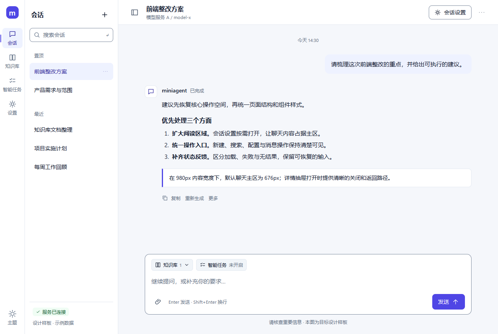
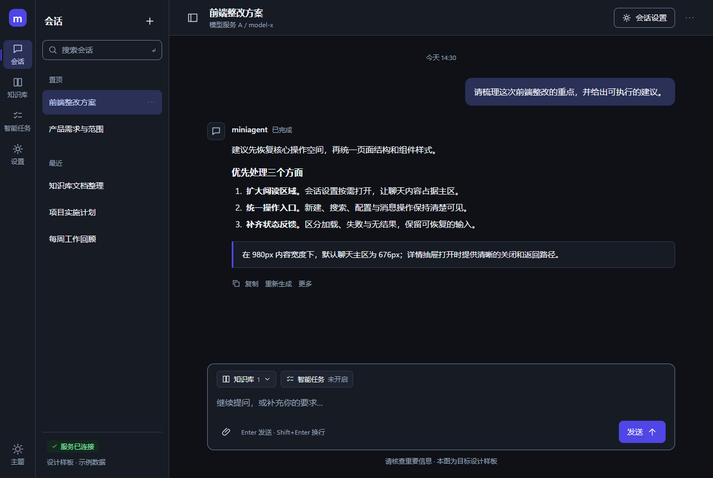
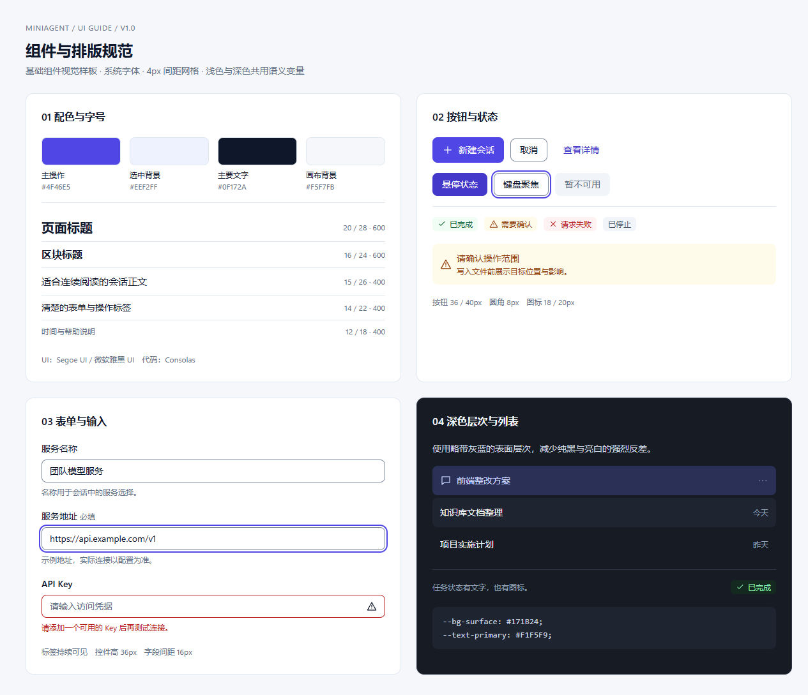

# miniagent 前端视觉与布局整改方案

日期：2026-11-20  
版本：设计规范 v1.0，待实施  
适用对象：Windows Electron 桌面端，Vue 3、Tailwind CSS 3；主窗口、快捷问答及相关弹层  
关联文档：[前端布局与易用性整改报告](前端布局与易用性整改报告-2026-11-20.md)

本方案规定整改后的配色、字体、字号、布局、组件和交互状态。目标是让用户清楚看到当前任务、顺利完成配置、获得足够的阅读和输入空间。后续实施以本文的尺寸、色值和状态规则为共同依据。

本文及配套样板表达目标设计，尚未应用到产品源码。原审查报告的 F01—F22 仍需按其功能要求修复；视觉调整不能替代搜索、草稿、删除、设置同步等逻辑整改。

## 1. 界面风格与基础规则

采用克制、清晰的桌面工具风格：中性灰蓝背景、靛蓝主要操作、明确的阅读层次，使用较少的边框和阴影区分区域。

| 设计事项 | 统一规则 |
|---|---|
| 首要内容 | 当前任务和阅读区域优先；高级配置通过面板按需打开 |
| 配色分工 | 中性色承载背景和文本，靛蓝标记主操作与选中，语义色只表示状态 |
| 强调数量 | 同一局部任务区域原则上只有一个主按钮；次要操作使用次按钮或文字按钮 |
| 信息密度 | 默认舒适密度；表格可用紧凑密度，仍保留可点击区域与完整说明 |
| 图标 | 统一 SVG 线性图标，常规 20px、线宽 1.75px；行内 16px；不混用 emoji 作功能导航 |
| 形状 | 控件圆角 8px、卡片与气泡 12px、对话框 16px；圆形仅用于头像和状态点 |
| 分隔方式 | 优先使用留白和背景分区；同级内容避免层层嵌套卡片 |
| 文案 | 中文为主；术语附解释，状态有文字标签；省略号统一使用“…” |
| 主题 | 首次使用跟随系统，保留浅色、深色、跟随系统三项；已有用户的明确主题偏好继续保留 |

## 2. 配色规范

### 2.1 中性色与品牌色

前端必须通过语义变量引用颜色。浅色和深色使用相同变量名；业务组件不直接散写 `zinc-*`、`indigo-*` 或十六进制色值。

| 变量 | 浅色 | 深色 | 使用位置 |
|---|---|---|---|
| `--bg-canvas` | `#F5F7FB` | `#0F1117` | 应用底色、内容区外层 |
| `--bg-surface` | `#FFFFFF` | `#171B24` | 页面主面板、输入框、普通卡片 |
| `--bg-subtle` | `#F1F5F9` | `#1E2430` | 侧栏、表头、悬停、辅助区域 |
| `--bg-elevated` | `#FFFFFF` | `#222938` | 菜单、浮层、抽屉 |
| `--border-subtle` | `#E2E8F0` | `#303849` | 装饰性分隔线、卡片边框 |
| `--border-control` | `#7C899D` | `#64748B` | 需要明确边界的输入框、复选框、次按钮 |
| `--text-primary` | `#0F172A` | `#F1F5F9` | 正文、标题、主要标签 |
| `--text-secondary` | `#475569` | `#CBD5E1` | 字段说明、次要操作 |
| `--text-muted` | `#5F6F85` | `#94A3B8` | 时间、提示、placeholder；不能用低透明度进一步减淡 |
| `--brand` | `#4F46E5` | `#4F46E5` | 主按钮背景，配白色文字 |
| `--brand-hover` | `#4338CA` | `#4338CA` | 主按钮悬停 |
| `--brand-active` | `#3730A3` | `#3730A3` | 主按钮按下 |
| `--brand-soft` | `#EEF2FF` | `#2A3056` | 选中行、品牌标签、用户消息背景 |
| `--brand-ink` | `#3730A3` | `#C7D2FE` | 选中项和品牌浅底文字 |
| `--link` | `#4338CA` | `#A5B4FC` | 文本链接，正文内加下划线 |
| `--focus` | `#4F46E5` | `#818CF8` | 键盘焦点环 |
| `--on-brand` | `#FFFFFF` | `#FFFFFF` | 品牌色按钮文字 |
| `--overlay` | `rgba(15,23,42,.40)` | `rgba(0,0,0,.56)` | 模态弹层遮罩 |

区分装饰边框与操作边框：`--border-subtle` 用于分组；输入框等需要识别边界时使用 `--border-control`，不能全部替换成低对比度装饰线。

### 2.2 状态色

| 状态 | 浅色文字 / 背景 | 深色文字 / 背景 | 图标和文案示例 |
|---|---|---|---|
| 成功 | `#166534` / `#F0FDF4` | `#86EFAC` / `#14291F` | 对勾 + 已完成、连接正常 |
| 警告 | `#92400E` / `#FFFBEB` | `#FCD34D` / `#302814` | 警告图标 + 需要确认、部分完成 |
| 错误 | `#B91C1C` / `#FEF2F2` | `#FCA5A5` / `#351E25` | 错误图标 + 请求失败、无效 Key |
| 信息 | `#1D4ED8` / `#EFF6FF` | `#BFDBFE` / `#1B2B45` | 信息图标 + 正在检索、提示 |
| 中性 | `--text-secondary` / `--bg-subtle` | 同名主题变量 | 已停止、未配置 |

危险操作的实心确认按钮使用 `#B91C1C` 背景、白字；hover 为 `#991B1B`。普通列表中的删除入口使用菜单文字或轻量危险按钮，不把整个页面染成红色。生成中使用靛蓝文字、状态图标与“生成中”，无需持续闪烁整块区域。

### 2.3 可读性验收

设计目标：普通文字与实际背景的对比度至少 4.5:1；关键控件边界和焦点标记至少 3:1。状态必须同时提供文字或图形，不能只靠红绿颜色区分。这是实施验收要求，不能据此宣称整个应用已经通过可访问性认证。

使用颜色相对亮度公式计算的基础组合如下；数值仅覆盖表中不透明颜色配对：

| 组合 | 浅色 | 深色 |
|---|---:|---:|
| 正文 / surface | 17.85:1 | 15.73:1 |
| 次要文字 / surface | 7.58:1 | 11.61:1 |
| 控件边框 / surface | 3.55:1 | 3.62:1 |
| 控件边框 / subtle | 3.24:1 | 3.27:1 |
| 白字 / 主按钮 | 6.29:1 | 6.29:1 |
| 焦点颜色 / surface | 6.29:1 | 5.78:1 |

正文禁止通过 `opacity: .4` 一类写法降低可读性。禁用控件用独立中性背景、文本与不可操作状态表示；同时说明缺少的前置条件。

## 3. 字体与字号

### 3.1 字体族

默认使用系统字体，不引入网络字体或为改版额外下载字体包。英文和数字优先 Segoe UI，中文由微软雅黑 UI 等系统中文字体承接。

```css
--font-ui: "Segoe UI Variable Text", "Segoe UI", "Microsoft YaHei UI",
  "Microsoft YaHei", "PingFang SC", sans-serif;
--font-code: "Cascadia Code", Consolas, "SFMono-Regular", monospace;
```

默认字重 400，表单标签、选中项和小标题 500，大标题和主要层级 600。中文字体缺少中间字重时允许系统映射；不使用 300 细字重。代码、路径、命令、Key 脱敏值使用等宽字体，常规说明仍使用 UI 字体。

### 3.2 字体层级

基准 `html` 字号为 16px，尺寸使用 rem 表达；下表 px 为 100% 缩放时的等效值。

| 用途 | 字号 | 行高 | 字重 | 规则 |
|---|---:|---:|---:|---|
| 首次使用欢迎标题 | 24px / 1.5rem | 32px | 600 | 一屏只出现一个 |
| 页面标题 | 20px / 1.25rem | 28px | 600 | 知识库名称、设置页标题 |
| 区块标题 | 16px / 1rem | 24px | 600 | 模型服务、检索结果等 |
| 会话正文 | 15px / .9375rem | 26px | 400 | 用户和助手消息均使用此级 |
| 常规 UI、输入、表格正文 | 14px / .875rem | 22px | 400 | 按钮、列表、表单主文本 |
| 辅助说明、时间、徽标 | 12px / .75rem | 18px | 400–500 | 承载次要信息，不用于主操作名称 |
| 代码块 | 13px / .8125rem | 21px | 400 | 可复制、独立横向滚动 |
| 导航文字 | 12px / .75rem | 18px | 500 | 配 20px 图标，替换原 10px 标签 |

聊天 Markdown 的 H1/H2/H3 分别为 22/19/16px，行高 32/28/24px；段落间距 12px，列表项间距 4px，引用内边距 12px。正文中的代码为 13px，使用背景和边框区分。长英文或 URL 允许换行；代码块和宽表格在自身容器滚动，不能撑宽主界面。

数字统计、时间列可使用 `font-variant-numeric: tabular-nums`。重要路径、模型 ID、错误原因不能只截断：提供 tooltip、展开或复制入口；tooltip 不承担唯一说明。

## 4. 间距、尺寸与层级

### 4.1 空间规则

采用 4px 基础网格：`4 / 8 / 12 / 16 / 24 / 32 / 48`。组件内图标与文字相距 8px；表单标签到控件 6px，帮助说明到控件 4px；同组字段相距 16px；区块相距 24px；页面外边距默认 24px，最小窗口减为 16px。

| 对象 | 统一尺寸 |
|---|---|
| 普通按钮、输入框、选择器 | 高 36px；普通按钮水平内边距 14px |
| 主操作按钮 | 高 40px，水平内边距 16px |
| 紧凑表格操作 | 高 32px；点击区域至少 32 × 32px |
| 图标按钮 | 普通 36 × 36px，工具栏可 32 × 32px；图标 18–20px |
| checkbox / radio | 图形 18px，连同标签形成至少 36px 高点击行 |
| 开关 | 36 × 20px，标签行高至少 36px；高风险操作不使用开关代替确认 |
| 会话列表行 | 最小 44px，可因副标题增高至 64px |
| 表格表头 / 数据行 | 最小 40 / 48px；错误说明较长时允许增高 |
| 卡片内边距 | 16px；大型设置分组 24px |
| 抽屉宽度 | 会话详情 320px；配置编辑 480px；均不超过窗口宽度减 32px |
| 对话框宽度 | 确认 480px、复杂表单 640px；最大高度 `calc(100dvh - 48px)` |

这些是最小高度或常规尺寸，不能用固定高度裁掉放大后的中文文字。窄窗口中按钮文案允许工具栏换行，表单字段改为单列。

### 4.2 圆角、边框与阴影

普通边框 1px；选中状态使用浅品牌背景和 2px 边缘标记，不让边框增粗引起布局位移。普通页面和卡片不加大阴影；菜单使用 `0 8px 24px rgba(15,23,42,.12)`，模态框使用 `0 20px 64px rgba(0,0,0,.24)`。深色阴影适度增强，仍以边框和背景区分层级。

键盘焦点统一 `outline: 2px solid var(--focus); outline-offset: 2px`，只在 `:focus-visible` 下显示；不得去掉原生 outline 后不提供替代。

### 4.3 浮层顺序

| 层级 | z-index | 内容 |
|---|---:|---|
| 基础内容 | 0 | 页面、列表、卡片 |
| 固定工具区 | 10 | 页头、表头、输入区 |
| 普通菜单 | 30 | 下拉、popover |
| 非模态抽屉 | 40 | 宽屏详情面板的覆盖形式 |
| 模态遮罩 / 模态内容 | 50 / 60 | 配置编辑、执行确认 |
| 当前模态内浮层 | 模态内容的局部 30 | 挂在当前 dialog 内，不能落在遮罩背后 |
| 通知 | 80 | 不遮挡确认框按钮，不抢焦点 |
| tooltip | 90 | 对应当前可交互元素 |

同时只允许一个主模态框；多个 Agent 确认请求显示队列数量并依次处理。

## 5. 主窗口布局

### 5.1 应用框架

主窗口仍以 980 × 640 外窗为最小支持尺寸，使用内容视口宽度计算布局。保留 Windows 原生标题栏，不在内容区重复绘制一套窗口控制按钮。

```text
┌──────┬───────────────────┬─────────────────────────────────────┐
│ 全局 │ 页内资源列表      │ 页面标题 / 当前模型 / 页面操作      │
│ 导航 │ 新建、搜索        ├─────────────────────────────────────┤
│      │                   │ 当前任务内容                        │
│ 会话 │ 会话 / 库 / 记录   │ 聊天 / 文档 / 执行步骤 / 设置表单   │
│ 知识 │                   │                                     │
│ 任务 │                   ├─────────────────────────────────────┤
│ 设置 │                   │ 当前页面的输入或必要操作区          │
│ 主题 │                   │                                     │
└──────┴───────────────────┴─────────────────────────────────────┘
```

全局导航固定 64px；图标和文字垂直排列，每项 52px 高；顶部保留 16px 留白，底部放主题入口。选中项使用品牌浅底、品牌文字和左侧标记。导航标题使用“会话、知识库、智能任务、设置”。

资源列表默认 240px，可拖宽至 220–320px，可收起；收起后在页头保留“展开列表”按钮，不能靠悬停恢复。每个资源列表顶部有标题和常驻新建入口，搜索独占下一行。

主区 `min-width: 0; min-height: 0`，页头默认 64px，正文区自适应。每个页面只保留一个主纵向滚动容器；资源列表独立滚动。正文、抽屉和表格不得把应用根节点撑出横向滚动。

### 5.2 宽度策略

| 内容视口 | 资源列表 | 会话设置 | 聊天主区策略 |
|---|---|---|---|
| 980–1179px | 默认 240px，可收起 | 默认关闭；打开为 320px 模态抽屉 | 980px 下默认主区 676px，扣左右 16px 留白后可读宽度 644px |
| 1180–1359px | 默认 240px，可调宽 | 默认关闭；仍以抽屉打开 | 1280px 下默认主区 976px，正文最大 840px 居中 |
| ≥1360px | 默认 240px，可调宽 | 用户主动固定后可停靠 320px | 仅剩余主区 ≥640px 时允许停靠，否则自动退回抽屉 |
| <980px 保护布局 | 列表改为抽屉 | 详情用模态抽屉 | 非当前标准支持尺寸；确保放大文字或异常窗口状态时控件可达 |

详情默认关闭，持久化用户的展开偏好与列表宽度。窗口变窄时临时降级为抽屉，不把用户设置永久清空。抽屉覆盖显示会遮挡部分内容，需提供明显关闭入口、Esc 关闭与焦点恢复；打开期间不得假装被遮挡内容仍可操作。

### 5.3 页面标题栏

左侧为列表开关、当前标题，标题可省略但完整名称可查看；模型和连接状态放在标题旁或第二行。右侧放本页主操作与更多菜单。最小窗口中优先保留主操作，其余收进更多菜单；标题长时可以增高至 80px，不挤掉按钮。

聊天标题栏示例：`需求分析  ·  服务 A / model-x    [会话设置] [更多]`。显示最终生效的模型，不能只显示“跟随默认”。没有可用模型时显示“尚未配置服务”及配置入口。

## 6. 各页面整改布局

### 6.1 会话页面

**列表：** 标题“会话”与新建按钮独立一行；下方 36px 搜索框带搜索图标、清空按钮。列表区按“置顶、最近”分组，分组标题为 12px。行内显示会话名，当前项始终有品牌浅底。更多按钮保留 32px 点击区，悬停和键盘聚焦均可见；重命名、置顶、导出、删除进入菜单。

**阅读区：** 内容最大宽度 840px，左右至少 16px。助手回复用主文本与轻量头像标识，默认不套厚重气泡；用户消息右对齐，使用 `--brand-soft` 与 `--text-primary`，最大占内容宽度 85%，内边距 12 × 16px、圆角 12px。较长文本可接近内容全宽。角色名称、生成状态、错误状态不依赖悬停显示。

**操作行：** 位于每条回答底部，高至少 32px。复制常驻或聚焦可见，编辑和更多次一级；仅可重生成的目标显示“重新生成”。错误回答展示原因、重试及查看详情。生成期间当前回答显示停止入口，页底主发送按钮也切为停止；两个入口作用于同一请求。

**输入区：** 与正文同宽居中；顶部是附件缩略图、知识库选择和智能任务模式；中间为可自动增高 textarea，初始约 64px、最高 160px；底部左侧说明快捷键，右侧为 40px 主按钮。整个输入区高度不超过视口 40%，更长内容在输入框内滚动。知识库选择通过有搜索和最大高度的 popover 打开，不能挤占整个聊天区。

**模式说明：** 普通对话按钮文案为“发送”；任务模式为“开始任务”。模式切换用文字、图标、背景和状态说明共同表达；开启任务时提示“可调用工具，涉及写入的操作将请求确认”。

**空态：** 无服务时展示“连接模型服务”与三步清单；有服务但无会话时展示“开始一段新会话”和建议问题；当前会话零消息时直接可输入。不显示无内容的常驻设置栏。

### 6.2 设置页面

设置使用“分组导航 + 当前组内容”，避免所有配置混在一个长页面里。分组为：模型服务、快捷键、智能任务、外观、数据。

分组导航占 200px，当前项高 40px；内容容器最大宽度 960px，页边距 24px。980px 窗口下全局导航 64px + 分组导航 200px，内容仍有 716px；分组导航不再套一层卡片。

模型服务页分为“默认服务”和“供应商列表”。供应商卡片首行显示名称、连接状态和更多菜单，次行显示脱敏地址与模型数量；主操作为“配置”。点击新增或配置，进入 640px 编辑对话框：

1. 基础信息：名称、服务地址，每行一个字段；URL 示例放在帮助文字中。
2. 访问凭据：添加 Key、备注、脱敏状态；明确“Key 添加后立即保存”。输入密钥提供显示/隐藏按钮。
3. 模型：拉取、搜索、复选、加入；只读列表显示已加入状态，独立视觉能力开关。
4. 高级设置：调度策略、探测模型和周期，默认折叠。

底部固定操作区为“取消”“保存配置”，有未保存更改时离开需提示；取消新增不生成占位供应商。配置测试位于凭据和模型准备好之后，测试有加载状态及具体结果。

快捷键用三行设置项，每行是名称、当前组合键、修改入口；不要求用户理解 Electron 快捷键字符串。外观页展示浅色、深色、跟随系统的缩略样式和单选状态。数据页把备份、恢复与危险操作分开；包含 Key 的导出选项需明确解释影响。

### 6.3 知识库页面

左栏仅保留列表、搜索和“新建知识库”；创建通过 480px 对话框进行。名称、向量模型服务、模型都有持久标签及说明；未配置向量模型时提供前往模型服务入口。

主区页头显示库名，副标题为“12 文档 · 356 分块 · 已就绪”；“导入文档”为主按钮，“重建索引”进入次按钮或菜单。正文分为“文档”和“检索测试”标签页。

文档表格列为：名称（弹性）、状态（96px）、分块数（80px）、更新时间（140px）、操作（48px）。长路径放在详情中，失败原因在行下展开，避免再塞一列挤占名称。表格容器需要时可独立横向滚动；名称保留完整查看和复制入口。支持导入中、就绪、失败状态及重试。

检索页的输入框和按钮组成一行，结果区显示命中数、来源、片段与“展开全文”。切库后显示本库查询，不保留其他库结果；零命中时给出调整问题的建议。

### 6.4 智能任务页面

左栏列表每项可两行：目标摘要、状态和时间；状态使用中文。主区顶部展示目标全文、状态、耗时、相关会话入口；仅运行中显示停止。

执行步骤以纵向时间线或可折叠步骤卡展示：工具名、目的、状态、耗时为摘要，参数与结果在展开区中。结果默认展示摘要，超过六行必须有“展开全部”和复制；错误信息直接可见，技术栈详情折叠。

待确认请求使用有遮罩的 480px 对话框，头部说明“需要允许写入文件”等具体目的，显示目标路径、影响与风险。默认焦点在“拒绝”，主操作文案具体到“允许写入”或“允许执行”。同类操作记忆选项有范围说明，破坏性操作不提供免确认承诺。顶部显示“待处理 1 / 3”，处理后逐个推进并返回原焦点。

### 6.5 快速问答、截图和悬浮球

快捷问答保持轻量窗口，使用与主界面相同的主题、字体、输入样式。标题栏 40px，保留拖动区；交互控件为 no-drag。底部有可点击“发送”按钮，复制和“主窗口继续”为次操作。固定高度约束下 textarea 从一行增高到三行后内部滚动，阅读区使用剩余高度；只展示近期消息时，顶部提示并提供完整历史入口。

划词模式把捕获文本放在可展开预览中，操作使用“翻译、总结、解释、自定义”，自定义输入与提交路径清楚可见。截图窗口保留尺寸提示和 Esc 说明，靠近屏幕上沿时将尺寸提示放到选框下方，避免出屏。悬浮球保留独立品牌形象，但需验证单击、拖动区分及高 DPI 清晰度。

## 7. 通用组件样式

| 组件 | 外观与结构 | 交互及状态要求 |
|---|---|---|
| 主按钮 | 靛蓝实底、白字、8px 圆角；主动作 40px 高 | hover 深一档，pressed 再深一档；loading 有文字，锁定重复提交；保持原宽度 |
| 次按钮 | surface 背景、control 边框、主文本 | hover 使用 subtle；focus 显示环；避免只有淡边框无明确文字 |
| 文字按钮 | 无背景，link 色，水平内边距 8px | hover 有浅底或下划线，点击区至少 32px；删除使用危险色 |
| 图标按钮 | 36px 方形，图标居中 | 必须有 accessible name 和 tooltip；不靠 tooltip 才能解释高风险操作 |
| 输入框 | 36px 起、14px 文字、8px 圆角、左右 12px | 标签独立存在；hover 加深边框；focus 环；error 有文本及图标；disabled 有原因 |
| textarea | 与输入框同系列，行高 22/26px，最小 2 行 | 按用途自动增高；编辑器宽度 100%，容器 min-width:0 |
| select / combobox | 与输入同高，右侧留 32px 箭头区 | 模型量多时支持搜索；展开方向和高度适配视口；选中项有勾选标记 |
| checkbox / radio | 图形 18px，与标签间隔 8px | 整行可点；禁用、半选、错误状态明确；保留键盘操作 |
| switch | 36 × 20px，中性关闭、品牌开启 | 与状态标签配对；即时保存失败要恢复原值并解释 |
| 分段切换 / tabs | 36–40px 高，选中项文字加深并有标记 | 与普通按钮区别；有 tab 或相应选择语义及键盘导航 |
| 列表项 | 44px 起、左右 12px、8px 圆角 | hover subtle，selected brand-soft；当前项与 hover 不混淆，聚焦仍显示操作 |
| 普通卡片 | surface、1px subtle 边框、12px 圆角、16px padding | 不给所有卡片加阴影；可点击卡片需提供清楚的操作入口和焦点 |
| 表格 | 14px 正文、subtle 表头、行分隔线 | 行内操作对齐；空态横跨全列；加载保持表结构；横滚限于表格 |
| 徽标 | 12px / 18px，左右 8px，上下 2px，6px 圆角 | 状态色浅底，图标加文字；不以仅有色点表达失败 |
| 菜单 / popover | elevated、1px 边框、12px 圆角、小阴影 | 菜单项高至少 36px；支持 Esc、方向键和焦点恢复 |
| dialog / drawer | elevated 或 surface、16px 圆角、固定头尾 | 主体滚动，头部有标题和关闭；模态具有焦点限制和遮罩 |
| toast | 320–400px 宽，自适应多行、图标与内容对齐 | 成功 4 秒关闭；重要错误保留并有关闭/重试；不抢焦点，状态可播报 |
| tooltip | 12px / 18px，最大 320px，允许多行 | 悬停与键盘聚焦均触发，约 400ms 延迟，Esc 可关闭 |
| skeleton | 低对比中性块，对齐最终文字与控件 | 不伪装成可点击控件；减少动画偏好下停止闪动 |

控件视觉状态至少覆盖：默认、悬停、按下、键盘聚焦、禁用、加载；输入组件额外覆盖只读、错误和帮助说明。每种状态的浅深主题都需要检查。

## 8. 动效、内容和反馈

动效采用短时反馈：按钮背景和边框 120ms，菜单 150ms，抽屉 180ms，普通过渡 `ease-out`。避免布局宽度反复动画导致阅读抖动；禁止无限闪烁的错误提示。尊重 `prefers-reduced-motion`，减少模式下取消非必要位移动画。

状态文案使用具体动作，例如“正在检索知识库…”“正在生成回答…”“保存失败，配置仍保留在本页”。失败后用户能重试或继续编辑；保存、发送成功后再清理草稿。正常内容中不展示堆栈、数据库字段名或内部枚举。

| 原显示 | 目标显示 |
|---|---|
| Agent | 智能任务（说明中可保留 Agent） |
| done / running / max_steps | 已完成 / 执行中 / 已达步骤上限 |
| temperature | 随机性；帮助说明显示 temperature |
| max_tokens | 最大输出长度；说明计量单位和模型限制 |
| score | 相关度；解释分数仅用于本次检索比较 |
| 0/0 | 0 文档 · 0 分块 |
| 跟随默认 | 默认选项名称可保留，同时显示最终生效服务与模型 |

成功、失败、空态与加载应分别设计。无搜索结果不能显示成“还没有数据”；请求失败不能显示成零命中；部分失败要说明成功数量和可重试对象。

## 9. 前端落地方式

### 9.1 样式组织

保留现有 Vue 与 Tailwind 技术栈，不为统一外观引入整套新 UI 框架。建议增加 `src/common/tokens.css`，由 `src/common/style.css` 统一导入；在 `tailwind.config.cjs` 映射语义颜色和字体。以下是实施模板，当前未新增这些产品文件。

```css
/* tokens.css 的基础模板；其余颜色按本文表格补齐 */
:root {
  color-scheme: light;
  --bg-canvas: #f5f7fb;
  --bg-surface: #ffffff;
  --bg-subtle: #f1f5f9;
  --bg-elevated: #ffffff;
  --border-subtle: #e2e8f0;
  --border-control: #7c899d;
  --text-primary: #0f172a;
  --text-secondary: #475569;
  --text-muted: #5f6f85;
  --brand: #4f46e5;
  --brand-hover: #4338ca;
  --brand-active: #3730a3;
  --brand-soft: #eef2ff;
  --brand-ink: #3730a3;
  --link: #4338ca;
  --focus: #4f46e5;
  --on-brand: #ffffff;
  --font-ui: "Segoe UI Variable Text", "Segoe UI", "Microsoft YaHei UI",
    "Microsoft YaHei", "PingFang SC", sans-serif;
  --font-code: "Cascadia Code", Consolas, "SFMono-Regular", monospace;
}
html.dark {
  color-scheme: dark;
  --bg-canvas: #0f1117;
  --bg-surface: #171b24;
  --bg-subtle: #1e2430;
  --bg-elevated: #222938;
  --border-subtle: #303849;
  --border-control: #64748b;
  --text-primary: #f1f5f9;
  --text-secondary: #cbd5e1;
  --text-muted: #94a3b8;
  --brand-soft: #2a3056;
  --brand-ink: #c7d2fe;
  --link: #a5b4fc;
  --focus: #818cf8;
}
body {
  margin: 0;
  font: 400 .875rem/1.571 var(--font-ui);
  color: var(--text-primary);
  background: var(--bg-canvas);
}
button, input, select, textarea { font: inherit; }
:focus-visible { outline: 2px solid var(--focus); outline-offset: 2px; }
.page-main, .scroll-region { min-width: 0; min-height: 0; }
.scroll-region { overflow-y: auto; }
.message-editor { width: 100%; max-width: 100%; min-width: 0; }
.message-text { overflow-wrap: anywhere; }
.code-scroll, .table-scroll { max-width: 100%; overflow-x: auto; }
```

`html.dark` 仍由主题 store 控制。系统主题监听和各窗口同步在主题逻辑中处理，不能仅靠 CSS 声称已完成。Tailwind 中例如将 `surface` 映射为 `var(--bg-surface)`、`primary` 文本映射为 `var(--text-primary)`；若需要透明色，显式定义相应 token，不能假定十六进制变量能直接使用所有 `/opacity` 工具类。

### 9.2 组件拆分与修改位置

以下为建议新增的共享组件，名称可以按项目风格微调，职责和行为应一致：

| 组件 / 模块 | 职责 | 现有改造位置 |
|---|---|---|
| `AppShell`、`AppNav` | 应用网格、导航、主题入口 | `src/entries/main-window/App.vue` |
| `ResourceSidebar` | 可收起列表、新建、搜索、宽度记忆 | `ChatView.vue`、`KbView.vue`、`AgentView.vue` |
| `PageHeader` | 标题、当前状态、操作收纳 | 四个主视图 |
| `UiButton`、`IconButton` | 统一尺寸、variant、loading、可访问名称 | 替换各页散落按钮 |
| `FormField`、`TextInput` | 标签、错误、帮助、ID 关联 | 设置、知识库、会话详情 |
| `UiDialog`、`UiDrawer` | 焦点、Esc、遮罩、关闭与恢复 | `ConfirmCard.vue`、配置和新建表单 |
| `StatusBadge`、`EmptyState` | 中文状态映射、空态与入口 | 知识库、任务、聊天 |
| `ChatComposer`、`ChatDetails` | 输入、附件、模式与会话参数 | `src/views/ChatView.vue` |
| `MessageActions` | 明确消息目标和状态的操作 | `src/components/MessageItem.vue` |
| `ToastRegion` | 通知队列、播报、错误持久化 | `App.vue`、`src/stores/ui.js` |
| 主题与布局状态 | 主题、列表宽度、详情偏好 | `src/stores/ui.js` 及设置持久化 |

公共组件只统一外观和基础交互，不把供应商删除、会话发送等业务全部塞入通用按钮。新布局优先 Grid/Flex，以 `minmax(0, 1fr)` 表达可压缩主区，禁止用固定消息编辑宽度弥补容器问题。

### 9.3 实施顺序

1. **基础规范：** 建立颜色、字体、尺寸变量及基础组件；先在浅深两主题的样板页验收。
2. **主流程：** 修改应用框架、会话列表、标题栏、阅读区、输入区、详情抽屉；同步修复 F01—F09 涉及的逻辑问题。
3. **资源与配置：** 设置分组、供应商编辑、知识库文档/检索、任务记录和确认队列；补齐加载、空态、失败状态。
4. **窗口统一：** 快捷问答主题与发送入口、截图提示、悬浮球缩放；进行跨窗口状态核查。
5. **整体回归：** 检查键盘、中文输入法、长内容、缩放、重启配置和深浅主题，保存同一组视口的前后对比。

每批以完整用户流程交付；不把“所有地方换上主色”作为完成标准。若恢复删除、历史回答分支等能力需要接口支持，应同时明确 UI 降级规则。

## 10. 验收矩阵

| 维度 | 必查条件 | 通过标准 |
|---|---|---|
| 主窗口布局 | 内容宽 980、1280、1920px | 聊天主区符合宽度策略；无全页横滚；侧栏、详情可收起 |
| 最小高度 | 原生外窗 980 × 640 附近 | 主要按钮、输入与弹层关闭始终可达，正文仍能滚动 |
| 字号与缩放 | Windows 100%、125%、150%，中文长标签 | 文字不被固定行高裁掉，按钮不只剩图标，焦点环完整 |
| 主题 | 浅色、深色、跟随系统及窗口切换 | 无浅底白字或深底黑字；原生输入控件主题匹配 |
| 颜色 | 正文、说明、按钮、警告、焦点实际背景 | 按本文目标测量；文字和控件状态不依赖颜色单独表达 |
| 组件状态 | default、hover、pressed、focus、disabled、loading、error | 浅深两套状态完整，无布局跳变或无意义禁用 |
| 内容边界 | 长标题、URL、表格、代码、图片、超长错误 | 只允许对应内容区内部滚动；全文有读取路径 |
| 模态与抽屉 | 最小窗口、长说明、多请求 | 头尾可见、主体滚动、焦点正确、Esc 和关闭规则一致 |
| 主流程 | 首次配置→提问→失败重试→复制→管理资源 | 入口明确、状态真实、输入与配置不丢失 |
| 键盘与输入法 | Tab、方向键、Enter、Shift+Enter、Esc、微软拼音 | 功能可完成；中文候选确认不误发；弹层关闭后焦点可恢复 |

交付前应保存会话、设置、知识库、任务、确认框、快捷窗的浅深主题截图。配套视觉样板只证明设计表达，不代表这些产品页面已完成回归。

## 11. 配套视觉样板

样板展示本方案的色彩、字号、布局与基础控件，均为设计示例内容，不连接真实业务。以本文数值表为实现依据，截图用于理解整体效果。

### 浅色会话布局



### 深色会话布局



### 基础组件和字号


